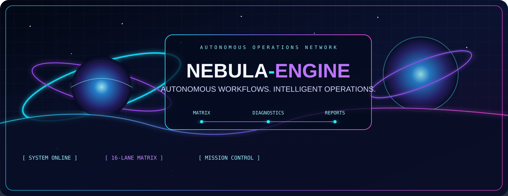

# 🌌 NEBULA-ENGINE
### AUTONOMOUS WORKFLOWS · INTELLIGENT OPERATIONS

<p align="center"></p>

<p align="center">
  
  
  
</p>

<p align="center">
  <a href="https://github.com/Latikeshh/NEBULA-ENGINE/actions/workflows/nebula-matrix-engine.yml"></a>
  <a href="https://github.com/Latikeshh/NEBULA-ENGINE/actions/workflows/nebula-full-scan.yml"></a>
  <a href="https://github.com/Latikeshh/NEBULA-ENGINE/actions/workflows/security-core.yml"></a>
</p>

> A GitHub Actions operations universe. Every node is a real job. Every connection represents an execution dependency. Every mission produces inspectable evidence.

## ✦ CONTROL ROOM

| Subsystem | Mission |
|---|---|
| 🧠 REPOSITORY BRAIN | Structure, activity, metadata and project signals |
| 🛡️ SECURITY CORE | Private-key marker checks and sensitive-path review |
| ⚡ CONSTELLATION MATRIX | Eight diagnostic domains with selectable execution depth |
| 🧪 BUILD INTELLIGENCE | Detect project ecosystems and build manifests |
| 📡 DEPENDENCY RADAR | Dependency and lockfile inventory |
| 📊 SIGNAL ANALYSIS | Mission status and execution telemetry |
| ◈ MISSION CONTROL | Final synthesis and run summary |

## 🚀 LAUNCH SEQUENCE

1. Open [MISSION CONTROL / GitHub Actions](../../actions).
2. Select **NEBULA // CONSTELLATION MATRIX**.
3. Choose **Run workflow**.
4. Select **QUICK** for 8 lanes or **DEEP** for 16 lanes.
5. Open the run to inspect the dependency graph, job logs and artifacts.

## 🧬 THE CONSTELLATION

The matrix is not a decorative grid. It fans out into independent subsystem jobs and converges through signal analysis into mission control.

| Domain | Scan signal |
|---|---|
| REPOSITORY | Tracked files, directory map and latest commit |
| SECURITY | Private-key marker patterns |
| DEPENDENCIES | Package manifests and lockfiles |
| BUILD | Build-system manifest discovery |
| PERFORMANCE | Repository footprint and commit history |
| RELEASE | Current ref and latest tag |
| DOCUMENTATION | README, license and contributor guidance |
| AUTOMATION | Workflow inventory |

**QUICK** executes one lane per domain (8 jobs). **DEEP** executes both QUICK and DEEP profiles (16 jobs), adding run, branch and runner telemetry.

## ◈ MISSION GRAPH

```text
                    ✦ STAR GATE
                         |
              CONSTELLATION MATRIX
                         |
       +---------+-------+-------+---------+
       |         |       |       |         |
   REPOSITORY SECURITY BUILD DEPENDENCIES ...
       |         |       |       |         |
       +---------+-------+-------+---------+
                         |
                   SIGNAL ANALYSIS
                         |
                  MISSION CONTROL
```

GitHub renders the actual job graph from job dependencies. NEBULA shapes that graph through meaningful stages, parallel lanes and convergence—not fake jobs or artificial delays.

## 🛰️ WORKFLOW FLEET

| Workflow | Trigger | Purpose |
|---|---|---|
| Full System Scan | Manual, push, weekly | Multi-stage diagnostics and report |
| Constellation Matrix | Manual, pull request | Selectable 8/16-lane diagnostic matrix |
| Repository Intelligence | Push, manual | Repository profile |
| Security Core | Push, pull request, manual | Lightweight secret-pattern scan |
| Dependency Radar | Weekly, manual | Dependency inventory |
| Workflow Doctor | Workflow changes, manual | YAML syntax validation |

## 📁 SYSTEM LAYOUT

```text
.github/workflows/
  nebula-full-scan.yml
  nebula-matrix-engine.yml
  repository-intelligence.yml
  security-core.yml
  dependency-radar.yml
  workflow-doctor.yml
assets/
  nebula-banner.svg
README.md
```

## 🔐 EXECUTION PROTOCOL

- Read-only repository permissions by default.
- No secret values are printed.
- Security pattern checks are lightweight checks, not a replacement for dedicated secret scanning.
- Dependency radar currently inventories manifests; it does not claim vulnerability analysis.
- Build intelligence currently detects ecosystems; project-specific build commands must be configured.
- Matrix parallelism depends on GitHub runner availability and account limits.
- Scheduled runs may be delayed by GitHub.
- No infinite loops, fake activity or decorative jobs.

## 🗺️ NEXT SYSTEMS

- [ ] Cross-run trend snapshots
- [ ] Real ecosystem-specific build and test adapters
- [ ] Dedicated code and dependency security scanning
- [ ] Release readiness scorecards
- [ ] Reusable workflow components

<p align="center"><strong>OBSERVE · ANALYZE · EXECUTE · REPORT</strong></p>
